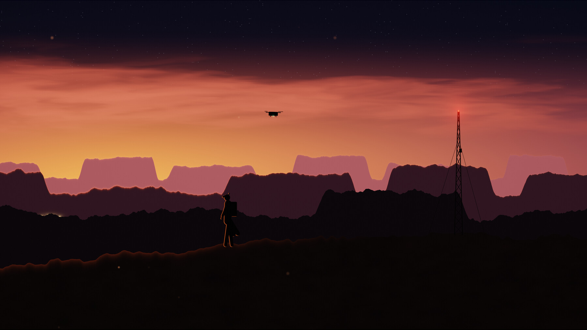

# Topside Outpost

An animated theme for [Omarchy](https://omarchy.org). Dusk over the mesas: a radio mast blinking, a drone on patrol, a convoy crawling through the valley.



## Install

```bash
omarchy theme install https://github.com/Gleasonmt/omarchy-topside-outpost-theme
omarchy plugin add https://github.com/Gleasonmt/omarchy-live-wallpaper --enable
```

Then pick **Topside Outpost** in Omarchy menu → Style → Theme. The first line is the theme
(colors, wallpaper, icons, keyboard lighting); the second makes the wallpaper move,
and also adds **Topside Outpost Lite** to the picker: the same picture with only small
parts moving, which uses the least power. Without the plugin you get the theme
with a still wallpaper.

Update with `omarchy theme update` and `omarchy plugin update`.

## How it moves

The wallpaper is a GPU shader (`live/2-outpost.frag.qsb`, source in `src/`) drawn by the
[live-wallpaper plugin](https://github.com/Gleasonmt/omarchy-live-wallpaper);
`backgrounds/2-outpost.png` is a frame of it, used by the lock screen and when the plugin
isn't installed. It pauses while a window covers the screen. See the plugin's README
for frame rates and battery settings.

Original artwork. The look is inspired by films and games; no logos or characters
are used.
