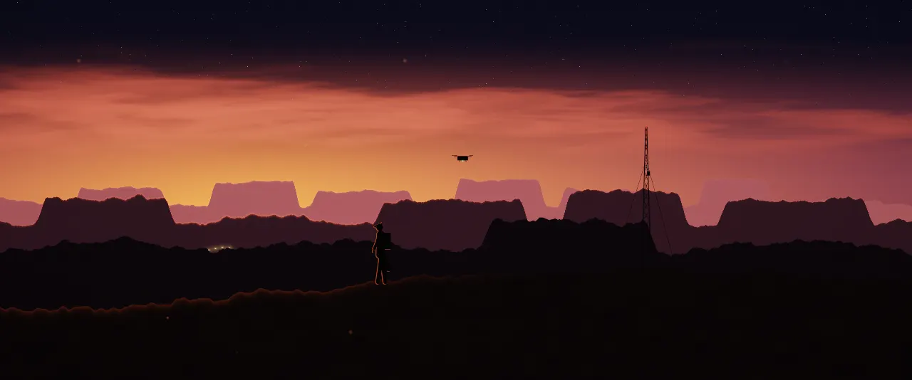

# Topside Outpost

An animated theme for [Omarchy](https://omarchy.org). Dusk over the mesas: a radio mast blinking, a drone on patrol, a convoy crawling through the valley.

> **Animated with [omarchy-live-wallpaper](https://github.com/Gleasonmt/omarchy-live-wallpaper).**
> Install that plugin too (below) to make the wallpaper move and to get the
> **Topside Outpost Lite** version. Without it the theme still works, with a still wallpaper.



## Install

Theme and plugin together:

```bash
omarchy theme install https://github.com/Gleasonmt/omarchy-topside-outpost-theme && omarchy plugin add https://github.com/Gleasonmt/omarchy-live-wallpaper --enable --yes
```

or one at a time:

```bash
omarchy theme install https://github.com/Gleasonmt/omarchy-topside-outpost-theme
omarchy plugin add https://github.com/Gleasonmt/omarchy-live-wallpaper --enable
```

Then pick **Topside Outpost** in Omarchy menu → Style → Theme. The first line is the theme
(colors, wallpaper, icons, keyboard lighting); the second makes the wallpaper move,
and also adds **Topside Outpost Lite** to the picker: the same picture with only small
parts moving, which uses the least power. Without the plugin you get the theme
with a still wallpaper.

Update with `omarchy theme update` and `omarchy plugin update`.

## Topside Outpost Lite

The same scene, still, with only its small details alive. It uses the least power,
which makes it good for battery or a calmer desktop:


## How it moves

The wallpaper is a GPU shader (`live/2-outpost.frag.qsb`, source in `src/`) drawn by the
[live-wallpaper plugin](https://github.com/Gleasonmt/omarchy-live-wallpaper);
`backgrounds/2-outpost.png` is a frame of it, used by the lock screen and when the plugin
isn't installed. It pauses while a window covers the screen. See the plugin's README
for frame rates and battery settings.

Original artwork. The look is inspired by films and games; no logos or characters
are used.

## Making changes

The scene is `src/<name>.frag` (with `src/common.glsl`): edit it, then run

```bash
tools/build.sh           # rebuilds live/, the still in backgrounds/ and preview.jpg
tools/build.sh --media   # also the animated previews in media/ (a few minutes)
```

and commit the results. Needs `qt6-shadertools`, `qt6-declarative`, ImageMagick and
(for `--media`) ffmpeg. To try a change on your own desktop, run
`omarchy theme update` after pushing, or copy the built files into
`~/.config/omarchy/themes/<name>/`.

## License

[MIT](LICENSE)
